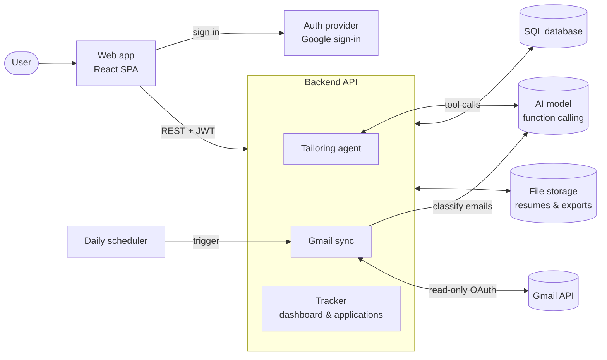

# ResumeBoost

**An AI agent that tailors your resume to any job description, then tracks the application for you from your Gmail inbox.**

🔗 **Live demo:** https://resume-boost-rose.vercel.app

Paste a job posting, pick a resume, and an AI agent rewrites it for that role: it finds missing keywords, rewords bullets, pulls in relevant experience you've used before, and asks you a question when it isn't sure. Every claim is checked against your original resume, so it never invents skills or numbers. Once you apply, ResumeBoost reads your inbox and moves each application from *Applied* → *Interviewing* → *Offer* or *Rejected* automatically.

---

## Highlights

- **Agentic tailoring, not a one-shot prompt.** The LLM runs in a tool-calling loop (parse → analyze job → find gaps → rewrite → verify → format check → render) and can pause mid-run to ask the user a question, then resume.
- **Hallucination guard.** Rewrites that add numbers, skills or employers not supported by the user's own history are blocked before they reach the user.
- **Human in control.** Every change is shown as a before/after diff that can be accepted, rejected or edited individually. The original resume is never modified in place.
- **Keeps your formatting.** Uploaded Word resumes are edited in place to preserve their look; PDF and DOCX exports use a clean single-column, ATS-friendly layout.
- **Automatic application tracking.** A daily background job scans new emails, classifies application updates (rules + LLM, cross-checked) and updates statuses. Tailored and inbox-found applications are merged, never duplicated.
- **Measurable match score.** A deterministic 0–100 ATS score (exact / synonym / missing keywords) shown before and after tailoring.
- **Runs at $0.** Designed to stay entirely on free tiers (hosting, database, LLM, scheduler) while scaling to many users.

---

## Screenshots

> Sample data shown (resume for **Jane Doe**, fictional companies).

| Dashboard | Tailor: proposed changes |
|---|---|
|  |  |
| **Tailor: agent asks a question** | **Applications** |
|  |  |
| **Application detail** | **Settings: resumes & experience bank** |
|  |  |

---

## How it works



---

## API

All `/api/*` endpoints except `health` and the OAuth callback require a signed-in user (Bearer JWT).

| Method | Endpoint | Purpose |
|---|---|---|
| `GET` | `/api/health` | Health check / wake-up |
| `GET` | `/api/me` | Current user |
| `GET` | `/api/dashboard` | Status ring, calendar events, upcoming interviews & follow-ups |
| `GET` | `/api/applications` | Application list + stats |
| `GET` | `/api/applications/{id}` | One application with emails and job description |
| `POST` | `/api/resumes/extract` | Extract text from an uploaded PDF/DOCX |
| `POST` | `/api/tailor/sessions` | Start a tailoring run (runs in the background) |
| `GET` | `/api/tailor/sessions/{id}` | Poll status, live agent trace and proposed changes |
| `POST` | `/api/tailor/sessions/{id}/answers` | Answer the agent's questions and resume the run |
| `POST` | `/api/tailor/sessions/{id}/score` | Re-score with the currently accepted changes |
| `POST` | `/api/tailor/sessions/{id}/finalize` | Apply decisions, export PDF/DOCX, save the application |
| `GET` | `/api/gmail/connect-url` | Google consent URL |
| `GET` | `/api/gmail/callback` | OAuth callback; stores encrypted token, starts first sync |
| `GET` | `/api/gmail/status` | Connection and last-sync status |
| `POST` | `/api/gmail/sync` | Sync now |
| `DELETE` | `/api/gmail` | Disconnect and revoke Gmail access |
| `DELETE` | `/api/account` | Delete account and all data |
| `POST` | `/internal/sync-all` | Daily sync for all users (scheduler only, secret header) |

---

## Future Roadmap

- **Conversational assistant.** A chat bot that can do anything the app can, in plain language: *"Tailor my backend resume for this posting," "Which applications haven't heard back in two weeks?," "Mark Acme as rejected," "Draft a follow-up to the recruiter at Globex."* Built on the same tool-calling agent, with existing endpoints exposed as tools and confirmation before any change.
- **Follow-up agent.** Drafts polite follow-up emails for applications that have gone quiet, for the user to review and send.
- **Cover letter generation** from the same resume + job analysis, with the same claim verification.
- **Interview prep.** Likely questions and talking points based on the job description and the tailored resume.
- **Job link import.** Paste a posting URL instead of the full text.
- **Agentic inbox sync.** Let the agent handle ambiguous emails (e.g. multi-role threads) instead of rules + single classification.
- **Calendar integration.** Push detected interviews to Google Calendar.
- **Analytics.** Response rate by role, source and match score to show which resumes work.
- **Browser extension** to tailor directly from a job board page.

---

## Security & privacy

- Gmail refresh tokens are encrypted at rest; access can be revoked from Settings at any time.
- Only job-related emails are processed; the app never sends or deletes mail.
- Row-level security in the database; the service key never reaches the browser.
- Users can delete their account and all stored data in one click.

---

## Local development

Requires **Node 20.19+** and **Python 3.11+**.

```bash
# 1) Backend
cd backend
python -m venv .venv
source .venv/bin/activate              # Windows: .venv\Scripts\activate
pip install -r requirements.txt
cp .env.example .env                   # fill in the values
python -m uvicorn app.main:app --reload --port 8000    # API docs: http://localhost:8000/docs

# 2) Frontend (new terminal)
cd frontend
npm install
cp .env.example .env.local             # fill in the values
npm run dev                            # http://localhost:5173
```

- In dev, Vite proxies `/api` to `localhost:8000`, so no CORS setup is needed.
- If the backend isn't running, pages fall back to sample data.
- Database: run the files in `backend/supabase/` in order (`schema.sql`, then `002`–`004`).
- Without an AI API key, tailoring still shows the keyword gap and score (no rewrites), and the Gmail tracker uses rules only.

**Tests**

```bash
cd backend
pip install -r requirements-dev.txt
python -m pytest -q
```
